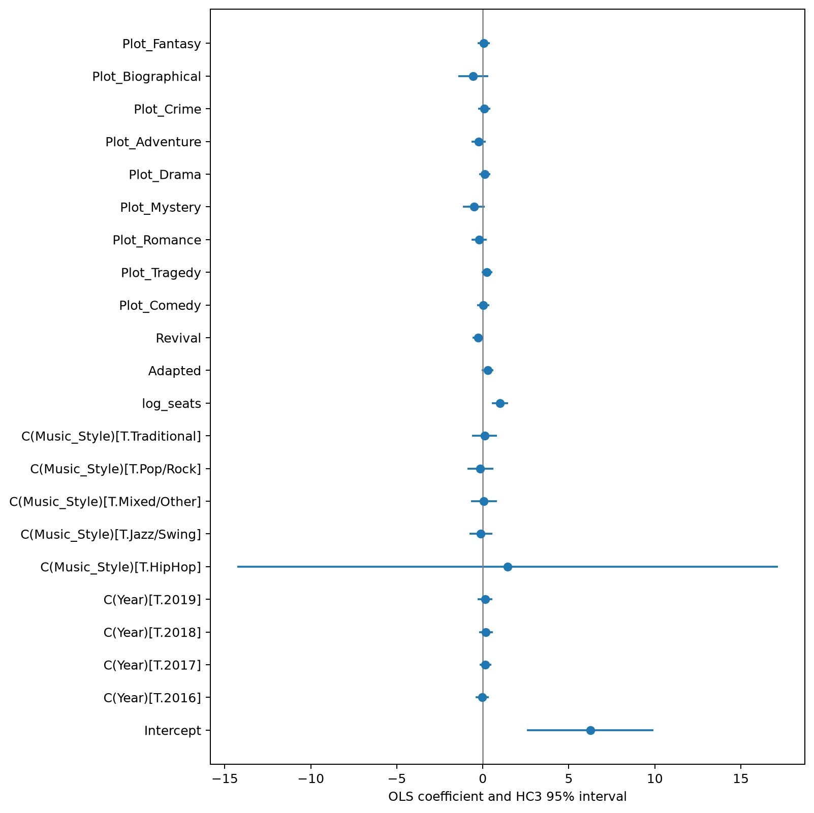

# Broadway Box Office Research

[](https://github.com/shacocn/broadway-box-office-research/actions/workflows/ci.yml)
[](https://github.com/shacocn/broadway-box-office-research/actions/workflows/pages.yml)

An auditable two-level study of Broadway box office performance. The production analysis reproduces the paper's aggregate OLS results for 67 musicals; a separate weekly analysis examines 501 observed market weeks. The public portfolio clearly separates exact benchmark reproduction from newly specified exploratory market models.

**[Open the interactive research dashboard](https://shacocn.github.io/broadway-box-office-research/)**

## Key findings

- The production model exactly reproduces the supplied benchmarks to a tolerance of `1e-6`: R² = **0.607957**, capacity coefficient = **1.007385**, HC3 p = **0.000036**, and adaptation coefficient = **0.286721**.
- Conditional on the recorded controls, a 1% difference in theatre capacity is associated with approximately a **1.01% difference in average weekly gross**. The HC3 95% interval is **0.530 to 1.485**. This is an association, not a causal effect.
- The positive capacity association remains in the prespecified sensitivity samples, including removal of the top 5% of productions by gross and restriction to productions observed for at least 20 weeks.
- Unemployment is unavailable for **244 of 501 market weeks (48.7%)**, concentrated in earlier years. Complete-case macroeconomic estimates therefore cover a selected period.
- The repaired A-D market extensions are full rank and use HAC(8) inference. They are independent exploratory analyses because the original market design matrices are unavailable.



## Research components

- [Interactive dashboard](https://shacocn.github.io/broadway-box-office-research/) — responsive Plotly views built from aggregate research outputs
- [Research report](research/report.md) — results, interpretation, and evidence boundary
- [Methodology](research/methodology.md) — OLS rationale, HC3/HAC inference, diagnostics, missingness, and sensitivity design
- [Limitations](research/limitations.md) — identification, measurement, scope, and data-access constraints
- [Related literature](research/related_work.md) — connections to Broadway economics and robust-inference methods
- [Executed notebooks](notebooks/) — data validation, exploration, regression, diagnostics, robustness, and market analysis
- [Machine-readable results](results/) — coefficients, diagnostics, benchmark comparisons, and public aggregate summaries

## Research traceability

- [Project structure map](docs/project_structure_map.md) — end-to-end flow from private research inputs through models, outputs, dashboard, and tests
- [Paper-to-code traceability](docs/paper_to_code_traceability.md) — claim-by-claim mapping to worksheets, notebooks, functions, result files, figures, and dashboard locations

## Reproduce with authorized inputs

Python 3.11 or later is required. The original six-sheet workbook is intentionally excluded because redistribution permission has not been established. Obtain authorized access, place the workbook in a private directory, and set `BROADWAY_INPUT_DIR` to that directory.

```bash
python -m venv .venv
python -m pip install -e ".[research,test]"
python -m broadway_research.pipeline \
  --input-dir "$BROADWAY_INPUT_DIR" \
  --output-dir .
python -m pytest -q
```

On Windows PowerShell, set the input location with:

```powershell
$env:BROADWAY_INPUT_DIR = "C:\path\to\authorized\private_inputs"
$env:BROADWAY_PRIVATE_INPUT_DIR = $env:BROADWAY_INPUT_DIR
```

Each notebook reads the same environment variable and performs the relevant computations directly from the authorized workbook. Executed notebook outputs contain aggregate statistics and unlabeled diagnostics only.

## Repository structure

```text
docs/       GitHub Pages dashboard, bundled assets, and research traceability
figures/    Reproducible static research figures
notebooks/  Five executed computational narratives
research/   Methodology, report, literature, and limitations
results/    Public aggregate results and validation summaries
src/        Installable Python analysis package
tests/      Artifact, integration, privacy, and scientific checks
```

## Statistical scope

The production model uses OLS because the reported estimand is a linear conditional association in log average weekly gross and direct numerical comparison with the supplied paper is required. HC3 covariance addresses leverage-sensitive heteroskedasticity in the small cross-section. Exploratory weekly models use HAC covariance with eight lags to allow short-run heteroskedasticity and serial correlation.

No observation is automatically removed as an outlier. Leverage, Cook's distance, residual behavior, design rank, and condition number are reported. Market model C replaces the rank-deficient combination of annual tourism and year fixed effects with elapsed time and a post-reopening indicator; its changed fit is not presented as an exact reproduction.

## Public-data boundary

The repository publishes code, executed notebooks, estimates, validation metadata, and disclosure-controlled aggregate summaries. It does **not** publish the source workbook, the paper, title-level source rows, or weekly source rows. No license or redistribution right is asserted over third-party data.

## Citation and attribution

Source coverage and paper benchmarks are documented in [research/source_coverage.md](research/source_coverage.md). Academic context is documented in [research/related_work.md](research/related_work.md). Gross values are nominal US dollars unless stated otherwise.
