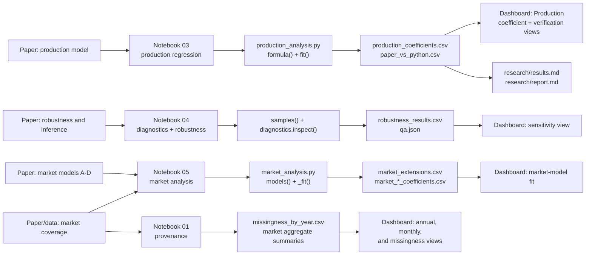

# Paper-to-code traceability

This document answers one practical question: **where did each result come from?** It maps the supplied paper's substantive claims to the authorized workbook, executed notebooks, Python functions, generated artifacts, dashboard locations, and research narrative.

The paper itself is not redistributed, and its exact section headings are not available in the public repository. The “paper reference” labels below are therefore content-based descriptions of the supplied paper rather than invented quotations or page titles. Use the authorized paper copy to add page numbers privately if needed.

## Traceability path

## Claim-by-claim mapping

| Paper reference | Claim or output in plain English | Source dataset or worksheet | Notebook(s) | Python module and function | Generated results | Figure or dashboard location | Classification | How it is produced |
|---|---|---|---|---|---|---|---|---|
| Data and sample construction | The analysis uses 67 production aggregates and a separate series of 501 observed Broadway market weeks. | Production worksheet selected by the `Show` column; market worksheet selected by `week_ending`. The workbook contains six sheets, but sheet names are not published. | [`01_data_and_provenance.ipynb`](../notebooks/01_data_and_provenance.ipynb) | [`ingest.load()`](../src/broadway_research/ingest.py); [`pipeline.run_pipeline()`](../src/broadway_research/pipeline.py) | [`data_dictionary.csv`](../results/data_dictionary.csv), [`qa.json`](../results/qa.json), [`validation_summary.json`](../results/validation_summary.json) | Dashboard hero metrics; [methodology: research design](../research/methodology.md#research-design-and-units-of-observation) | **Descriptive summary** | `load()` identifies the two analysis tables by schema. The pipeline requires exact source shapes `(67, 19)` and `(501, 21)` and checks dates, duplicates, positive gross, and log transformations. |
| Production descriptive evidence | Production gross and capacity vary substantially; adapted/revival and creative groups can be summarized descriptively. | Production worksheet (`Show` table). | [`02_exploratory_analysis.ipynb`](../notebooks/02_exploratory_analysis.ipynb) | [`pipeline._public_aggregates()`](../src/broadway_research/pipeline.py) | [`production_group_summary.csv`](../results/production_group_summary.csv), [`production_style_summary.csv`](../results/production_style_summary.csv), [`plot_category_summary.csv`](../results/plot_category_summary.csv) | [`gross_distribution.png`](../figures/gross_distribution.png), [`capacity.png`](../figures/capacity.png), [`groups.png`](../figures/groups.png) | **Descriptive summary** | The notebook recomputes distributions and group summaries from the workbook. Public style means are suppressed when a cell has fewer than three productions. |
| Main production specification | Log average weekly gross is regressed on log theatre capacity, adaptation, revival, year, music style, and plot indicators. | Production worksheet (`Show` table). | [`03_production_regression.ipynb`](../notebooks/03_production_regression.ipynb) | [`production_analysis.formula()`](../src/broadway_research/production_analysis.py), [`production_analysis.fit()`](../src/broadway_research/production_analysis.py) | [`production_coefficients.csv`](../results/production_coefficients.csv), [`paper_vs_python.csv`](../results/paper_vs_python.csv) | Dashboard **Production → Coefficient estimates**; [`coefficients.png`](../figures/coefficients.png); [results: exact reproduction](../research/results.md#exact-aggregate-production-reproduction) | **Exact reproduction** | `formula()` selects every `Plot_` column plus the documented production controls. `fit()` runs OLS and requests HC3 covariance. The pipeline compares four computed metrics with stored paper benchmarks at `1e-6` tolerance. |
| Production model fit | The production model has R² `0.607957` and adjusted R² `0.425003`. | Production worksheet. | [`03_production_regression.ipynb`](../notebooks/03_production_regression.ipynb) | `production_analysis.fit()`; `pipeline.run_pipeline()` | [`paper_vs_python.csv`](../results/paper_vs_python.csv), [`robustness_results.csv`](../results/robustness_results.csv) | Dashboard hero and **Paper versus Python** card; [research report: main results](../research/report.md#main-production-results) | **Exact reproduction** | R² is read from the fitted OLS result. The reported paper R² and computed Python R² differ by less than `1e-15`. |
| Capacity result | The `log_seats` coefficient is `1.007385`; its HC3 95% interval is `0.529649` to `1.485121`, with p = `0.0000358`. | Production worksheet. | [`03_production_regression.ipynb`](../notebooks/03_production_regression.ipynb) | `production_analysis.fit()`; `pipeline.run_pipeline()` | [`production_coefficients.csv`](../results/production_coefficients.csv), [`paper_vs_python.csv`](../results/paper_vs_python.csv) | Dashboard **Production → Coefficient estimates** and **Paper versus Python**; [`coefficients.png`](../figures/coefficients.png) | **Exact reproduction** | OLS estimates the `log_seats` coefficient under the paper-aligned formula; statsmodels calculates HC3 uncertainty. Because outcome and capacity are logged, the estimate is elasticity-like, but it remains an association rather than the causal effect of adding seats. |
| Adaptation and revival results | Adaptation is positive (`0.286721`) and revival is negative (`−0.284169`), but both HC3 intervals include zero. | Production worksheet. | [`03_production_regression.ipynb`](../notebooks/03_production_regression.ipynb) | `production_analysis.fit()` | [`production_coefficients.csv`](../results/production_coefficients.csv), [`paper_vs_python.csv`](../results/paper_vs_python.csv) | Dashboard **Findings → Adaptation and revival evidence is weaker**; coefficient chart | Adaptation benchmark: **exact reproduction**. Revival and interval interpretation: **paper-aligned analysis**. | The two indicator coefficients are estimated in the same multivariable model. The pipeline verifies the paper's adaptation coefficient; all coefficient intervals are calculated from the fitted HC3 covariance. |
| Production robust inference | HC3 standard errors are used because the production cross-section is small and leverage is uneven. | Production worksheet and fitted model matrix. | [`03_production_regression.ipynb`](../notebooks/03_production_regression.ipynb), [`04_diagnostics_and_robustness.ipynb`](../notebooks/04_diagnostics_and_robustness.ipynb) | `production_analysis.fit()`; [`diagnostics.inspect()`](../src/broadway_research/diagnostics.py) | [`production_coefficients.csv`](../results/production_coefficients.csv), [`qa.json`](../results/qa.json) | Dashboard **Methods → Robust uncertainty**; [methodology: production inference](../research/methodology.md#production-specification-and-inference) | **Exact reproduction of reported inference choice**, plus **methodological explanation** | `fit()` passes `cov_type='HC3'`. Diagnostics report rank, condition number, and maximum leverage so the reason for leverage-aware uncertainty is visible. |
| Outlier and influence assessment | No production is automatically removed; leverage, Cook's distance, residual behavior, and sensitivity samples are examined. | Production worksheet and fitted model matrix. | [`04_diagnostics_and_robustness.ipynb`](../notebooks/04_diagnostics_and_robustness.ipynb) | `diagnostics.inspect()`; `production_analysis.samples()`; statsmodels `get_influence()` inside `pipeline.run_pipeline()` | [`qa.json`](../results/qa.json); locally generated `results/influence.csv` is intentionally ignored by Git | [`residuals.png`](../figures/residuals.png); [methodology: diagnostics](../research/methodology.md#diagnostics-and-outlier-handling) | **Descriptive diagnostic** | The notebook recomputes matrix geometry and observation influence. Influence rows are not published because they could increase disclosure risk; aggregate diagnostics remain public. |
| Production sensitivity analysis | The capacity association remains positive without `Hamilton`, without the top 5% by gross, and among productions observed for at least 20 weeks. | Production worksheet. | [`04_diagnostics_and_robustness.ipynb`](../notebooks/04_diagnostics_and_robustness.ipynb) | `production_analysis.samples()`, `production_analysis.fit()` | [`robustness_results.csv`](../results/robustness_results.csv) | Dashboard **Production → Capacity association across sample definitions**; [results: sensitivity](../research/results.md#prespecified-production-sensitivity-analysis) | **Robustness check** | `samples()` constructs four deterministic samples and reuses the unchanged production formula. Excluding `Hamilton` also removes the only HipHop observation, so category support changes. |
| Market model A | Weekly log market gross is associated with holiday, month, and year controls; extension R² is `0.506952` versus paper-reported `0.507`. | Market worksheet (`week_ending` table). | [`05_market_analysis.ipynb`](../notebooks/05_market_analysis.ipynb) | [`market_analysis._specifications()`](../src/broadway_research/market_analysis.py), `market_analysis._fit()`, `market_analysis.models()` | [`market_extensions.csv`](../results/market_extensions.csv), [`market_A_coefficients.csv`](../results/market_A_coefficients.csv) | Dashboard **Market → Market model fit** | **Exploratory extension**, not exact reproduction | The explicit calendar formula is fit chronologically with HAC(8). Similar fit is not proof of identical design because the original market matrix is unavailable. |
| Market model B | Adding unemployment and monthly sentiment produces a 257-week complete-case extension with R² `0.698749`. | Market worksheet; missing macro fields are retained until model-specific complete-case filtering. | [`05_market_analysis.ipynb`](../notebooks/05_market_analysis.ipynb) | `market_analysis._fit()`, `market_analysis.models()` | [`market_extensions.csv`](../results/market_extensions.csv), [`market_B_coefficients.csv`](../results/market_B_coefficients.csv) | Dashboard **Market → Market model fit** | **Exploratory extension**, not exact reproduction | `_fit()` drops rows missing the variables required by model B before Patsy builds categorical levels, preventing unused all-zero year columns. HAC uses eight observed lags. |
| Market model C | The public implementation uses month effects, elapsed time, a post-reopening indicator, unemployment, monthly sentiment, and annual tourism. It is full rank with R² `0.707511`, not the paper-reported `0.671`. | Market worksheet. | [`05_market_analysis.ipynb`](../notebooks/05_market_analysis.ipynb) | `market_analysis.models()`, `_specifications()`, `_fit()`; `diagnostics.inspect()` | [`market_extensions.csv`](../results/market_extensions.csv), [`market_C_coefficients.csv`](../results/market_C_coefficients.csv) | Dashboard **Market → Market model fit**; [methodology: market extensions](../research/methodology.md#market-extensions-and-hac-inference) | **Methodological repair** and **exploratory extension** | Annual tourism is constant within year and is exactly collinear with a full set of year indicators. The repair replaces year fixed effects with continuous elapsed time and adds a coarse post-reopening break. The changed design and fit are explicitly not an exact reproduction. |
| Market model D | The semiannual-sentiment extension uses 257 complete cases and has R² `0.696198`. | Market worksheet. | [`05_market_analysis.ipynb`](../notebooks/05_market_analysis.ipynb) | `market_analysis._fit()`, `market_analysis.models()` | [`market_extensions.csv`](../results/market_extensions.csv), [`market_D_coefficients.csv`](../results/market_D_coefficients.csv) | Dashboard **Market → Market model fit** | **Exploratory extension**, not exact reproduction | The model uses holiday, month, year, unemployment, and semiannual sentiment terms with HAC(8). Unused categorical levels are removed by sampling before design construction. |
| Unemployment missingness | Unemployment is missing for 244 of 501 observed weeks (`48.7%`), concentrated in earlier years. | Market worksheet, `unemployment_rate_pct`. | [`01_data_and_provenance.ipynb`](../notebooks/01_data_and_provenance.ipynb), [`05_market_analysis.ipynb`](../notebooks/05_market_analysis.ipynb) | `pipeline.run_pipeline()` | [`missingness_by_year.csv`](../results/missingness_by_year.csv), [`qa.json`](../results/qa.json), [`dashboard_data.json`](../results/dashboard_data.json) | Dashboard **Market → Unemployment coverage by year**; [`missingness.png`](../figures/missingness.png); [results: missingness](../research/results.md#missingness-and-evidence-boundary) | **Descriptive summary** | The pipeline creates a missing-value indicator, groups it by year, and verifies the total equals 244. No missing values are imputed. |
| Market trends and seasonality | Annual and monthly mean weekly gross and attendance describe the observed market path, including partial years and reopening. | Market worksheet. | [`05_market_analysis.ipynb`](../notebooks/05_market_analysis.ipynb) | `pipeline._public_aggregates()` | [`market_annual_summary.csv`](../results/market_annual_summary.csv), [`market_monthly_summary.csv`](../results/market_monthly_summary.csv), [`market_season_summary.csv`](../results/market_season_summary.csv), [`market_quarter_summary.csv`](../results/market_quarter_summary.csv), [`market_holiday_summary.csv`](../results/market_holiday_summary.csv) | Dashboard **Market → Annual market profile** and **Mean gross by month**; [`market.png`](../figures/market.png) | **Descriptive summary** | The pipeline groups observed weeks by year, month, season, quarter, and holiday status. Shutdown gaps are not interpolated, 2020/2021/2026 are partial observed years, and dollar values are nominal. |
| Reproducibility validation | Production benchmarks must match, source shapes and missingness must be correct, market models must be full rank, notebooks must be executed, and public artifacts must exist. | Authorized workbook for integration tests; committed public artifacts for CI-safe tests. | All five notebooks | `pipeline.run_pipeline()`; [`tests/test_research.py`](../tests/test_research.py); [`tests/test_pipeline_integration.py`](../tests/test_pipeline_integration.py) | [`validation_summary.json`](../results/validation_summary.json), all generated artifacts | GitHub Actions **Research artifact checks**; dashboard assets | **Validation layer** | Public CI checks committed outputs without private data. With `BROADWAY_PRIVATE_INPUT_DIR`, integration tests rerun the actual analysis in a temporary directory and verify benchmark, rank, privacy, figure, and site-preservation conditions. |

## Fast answers to common provenance questions

### “How did you get the 1.007385 coefficient?”

The authorized production worksheet is loaded by `ingest.load()`. [`03_production_regression.ipynb`](../notebooks/03_production_regression.ipynb) calls `production_analysis.fit()`, which fits the formula returned by `production_analysis.formula()` using OLS with HC3 covariance. The `log_seats` row is written to [`production_coefficients.csv`](../results/production_coefficients.csv) and verified against the paper benchmark in [`paper_vs_python.csv`](../results/paper_vs_python.csv).

### “Which notebook reproduces the main production regression?”

[`03_production_regression.ipynb`](../notebooks/03_production_regression.ipynb). Notebook 04 evaluates diagnostics and sensitivity but does not replace the main specification.

### “Why is model C not an exact reproduction?”

The original market design matrix is unavailable, and a specification containing both annual tourism and full year fixed effects is rank deficient because tourism is constant within each year. The public model C replaces year fixed effects with elapsed time and adds a post-reopening indicator. That is a documented methodological repair with a different estimand and R².

### “Where does 244 missing unemployment observations come from?”

It is the direct count of missing `unemployment_rate_pct` values in the 501-row market worksheet. Notebook 05 recomputes the count, `pipeline.run_pipeline()` asserts it, [`missingness_by_year.csv`](../results/missingness_by_year.csv) shows the year distribution, and `test_missingness()` verifies the total and yearly pattern.

### “Which parts are exact and which are new?”

- **Exact reproduction:** the aggregate production model benchmarks, including R², capacity coefficient and p-value, and adaptation coefficient.
- **Paper-aligned analysis:** the remaining production coefficient table and HC3 intervals under the same documented formula.
- **Robustness and diagnostics:** the prespecified production sample checks and influence assessment.
- **Exploratory extensions:** market models A, B, and D, even when their R² values are close to the paper.
- **Methodological repair:** market model C.
- **Descriptive summaries:** distributions, group summaries, market trends, seasonality, and missingness.
