# Project structure map

This map explains how evidence moves through the Broadway Box Office Research repository. It distinguishes private research inputs from public code and outputs, and it keeps the production and market analyses separate because they use different units of observation.

## End-to-end information flow

```mermaid
flowchart LR
    PAPER["Research paper<br/>private reference"]
    WORKBOOK["Authorized six-sheet workbook<br/>private input"]

    LOAD["Data loading<br/>src/broadway_research/ingest.py<br/>load()"]
    VALIDATE["Schema and integrity validation<br/>pipeline.run_pipeline()<br/>Notebook 01"]

    PROD["Production path<br/>67 title-level aggregates"]
    PMODEL["OLS + HC3<br/>production_analysis.py<br/>formula(), fit(), samples()"]
    PDIAG["Diagnostics and sensitivity<br/>diagnostics.inspect()<br/>Notebooks 03-04"]

    MARKET["Market path<br/>501 observed weeks"]
    MMODEL["Exploratory OLS + HAC(8)<br/>market_analysis.py<br/>models(), _fit()"]
    MREPAIR["Model C repair<br/>elapsed time + reopening break<br/>Notebook 05"]

    RESULTS["Generated result files<br/>results/*.csv and *.json"]
    FIGURES["Generated static figures<br/>figures/*.png"]
    DASH["Interactive dashboard<br/>docs/index.html<br/>docs/assets/"]
    RESEARCH["Research narrative<br/>research/*.md"]
    TESTS["Validation<br/>tests/test_research.py<br/>tests/test_pipeline_integration.py"]

    PAPER -->|reported production benchmarks| PMODEL
    PAPER -->|reported market N and R² context| MMODEL
    WORKBOOK --> LOAD --> VALIDATE
    VALIDATE --> PROD --> PMODEL --> PDIAG
    VALIDATE --> MARKET --> MMODEL --> MREPAIR
    PDIAG --> RESULTS
    PDIAG --> FIGURES
    MREPAIR --> RESULTS
    MREPAIR --> FIGURES
    RESULTS --> DASH
    FIGURES --> DASH
    RESULTS --> RESEARCH
    PMODEL --> TESTS
    MREPAIR --> TESTS
    RESULTS --> TESTS
    DASH --> TESTS

    style PAPER fill:#fff4dc,stroke:#a66a00,color:#402a00
    style WORKBOOK fill:#fff4dc,stroke:#a66a00,color:#402a00
    style RESULTS fill:#e8f4f2,stroke:#1f8d8b,color:#10283d
    style DASH fill:#e8f4f2,stroke:#1f8d8b,color:#10283d
    style TESTS fill:#e8f4f2,stroke:#1f8d8b,color:#10283d
```

The paper and source workbook are inputs to the research process, but neither is redistributed. The public repository contains the computational implementation, executed notebooks, derived estimates, disclosure-controlled summaries, figures, documentation, and tests.

## Directory map

| Path | Purpose | Produced or maintained by | Start here when... |
|---|---|---|---|
| [`README.md`](../README.md) | Public overview, findings, live demo, and reproduction commands. | Maintained research narrative. | You need the fastest orientation. |
| [`data/README.md`](../data/README.md) | Explains the private-input boundary and provider attribution. No source rows are stored here. | Maintained research narrative. | You need to explain why the workbook is absent. |
| [`notebooks/`](../notebooks/) | Five executed computational narratives that load the authorized workbook and recompute the analysis. | Executed code plus explanatory Markdown. | You want to follow the analysis in research order. |
| [`src/broadway_research/`](../src/broadway_research/) | Installable Python implementation used by the notebooks, pipeline, and tests. | Maintained source code. | You need the authoritative formula or function. |
| [`results/`](../results/) | Public model estimates, benchmark checks, diagnostics, missingness, aggregate summaries, and dashboard data. | Generated by `pipeline.run_pipeline()`. | You need a machine-readable value. |
| [`figures/`](../figures/) | Reproducible static PNG figures for the research record and README preview. | Generated by `pipeline.run_pipeline()`. | You need a static visual or figure provenance. |
| [`docs/`](.) | GitHub Pages dashboard, bundled Plotly/CSS/JavaScript, and research traceability documentation. | Maintained presentation layer using real aggregate outputs. | You need the live presentation or provenance map. |
| [`research/`](../research/) | Methodology, results, report, literature context, limitations, source coverage, and reproducibility details. | Maintained research narrative. | You need an academic explanation or evidence boundary. |
| [`tests/`](../tests/) | Deterministic artifact checks plus authorized-input end-to-end integration tests. | Automated validation. | You need evidence that the repository reproduces correctly. |
| [`.github/workflows/`](../.github/workflows/) | Continuous integration and GitHub Pages deployment. | GitHub Actions. | You need deployment or CI provenance. |

## Notebook sequence

1. [`01_data_and_provenance.ipynb`](../notebooks/01_data_and_provenance.ipynb) loads the workbook, identifies the production and market tables, and validates shapes, types, dates, transformations, duplicates, and missingness.
2. [`02_exploratory_analysis.ipynb`](../notebooks/02_exploratory_analysis.ipynb) computes production distributions and descriptive group comparisons.
3. [`03_production_regression.ipynb`](../notebooks/03_production_regression.ipynb) recomputes the paper-aligned production OLS model and HC3 inference, including the 1.007385 capacity coefficient.
4. [`04_diagnostics_and_robustness.ipynb`](../notebooks/04_diagnostics_and_robustness.ipynb) evaluates influence, matrix geometry, residual behavior, and the four prespecified sensitivity samples.
5. [`05_market_analysis.ipynb`](../notebooks/05_market_analysis.ipynb) audits the weekly series, fits the exploratory HAC(8) models, and demonstrates the full-rank model C repair.

## Python module responsibilities

| Module | Main functions | Responsibility |
|---|---|---|
| [`ingest.py`](../src/broadway_research/ingest.py) | `load(path)` | Reads the first authorized `.xlsx` file in the supplied directory, selects the production worksheet by its `Show` column and the market worksheet by `week_ending`, and parses market dates. |
| [`production_analysis.py`](../src/broadway_research/production_analysis.py) | `formula(p)`, `fit(p)`, `samples(p)` | Defines the paper-aligned production formula, fits OLS with HC3 covariance, and constructs the four sensitivity samples. |
| [`diagnostics.py`](../src/broadway_research/diagnostics.py) | `inspect(f)` | Reports design rank, column count, condition number, and maximum leverage for a fitted model. |
| [`market_analysis.py`](../src/broadway_research/market_analysis.py) | `_specifications()`, `_fit()`, `models()`, `model_notes()` | Defines the four transparent market extensions, applies complete-case sampling, fits HAC(8), and constructs the elapsed-time and post-reopening terms used by repaired model C. |
| [`pipeline.py`](../src/broadway_research/pipeline.py) | `run_pipeline()`, `_public_aggregates()` | Runs the complete analysis, checks benchmarks, writes public results and figures, applies small-cell suppression, and produces validation metadata. It deliberately does not overwrite `docs/` or `research/`. |

## Output families

| Output family | Key files | What they establish |
|---|---|---|
| Paper benchmark comparison | [`paper_vs_python.csv`](../results/paper_vs_python.csv) | The four production benchmarks match within `1e-6`. |
| Production estimates | [`production_coefficients.csv`](../results/production_coefficients.csv), [`robustness_results.csv`](../results/robustness_results.csv), [`qa.json`](../results/qa.json) | Coefficients, HC3 inference, sample sensitivity, integrity checks, and design diagnostics. |
| Market estimates | [`market_extensions.csv`](../results/market_extensions.csv), [`market_A_coefficients.csv`](../results/market_A_coefficients.csv), [`market_B_coefficients.csv`](../results/market_B_coefficients.csv), [`market_C_coefficients.csv`](../results/market_C_coefficients.csv), [`market_D_coefficients.csv`](../results/market_D_coefficients.csv) | Explicit exploratory formulas, HAC(8) estimates, paper fit context, and full-rank verification. |
| Missingness and trends | [`missingness_by_year.csv`](../results/missingness_by_year.csv), [`market_annual_summary.csv`](../results/market_annual_summary.csv), [`market_monthly_summary.csv`](../results/market_monthly_summary.csv), [`market_season_summary.csv`](../results/market_season_summary.csv) | The 244 missing unemployment observations and disclosure-controlled market summaries. |
| Dashboard feed | [`dashboard_data.json`](../results/dashboard_data.json) | Strict JSON containing only public aggregate metrics and summaries. |
| Validation | [`validation_summary.json`](../results/validation_summary.json) | Source shapes, production benchmark status, market rank status, and aggregate-output count. |

## Presentation and validation boundary

The live [research dashboard](index.html) presents aggregate findings through six Plotly views. Its browser code is in [`assets/app.js`](assets/app.js), styling is in [`assets/styles.css`](assets/styles.css), and Plotly is bundled locally in [`assets/plotly.min.js`](assets/plotly.min.js). The dashboard does not expose the private title-level or weekly source tables.

[`test_research.py`](../tests/test_research.py) validates committed research outputs, notebook execution, figures, dashboard assets, benchmark tolerances, missingness, and full-rank market models. [`test_pipeline_integration.py`](../tests/test_pipeline_integration.py) reruns the real pipeline in a temporary directory when an authorized workbook is available and confirms that maintained website content is not overwritten.

For a claim-by-claim map, continue to [`paper_to_code_traceability.md`](paper_to_code_traceability.md). Reproduction commands and the authorized-input boundary are documented in the repository [`README.md`](../README.md).
